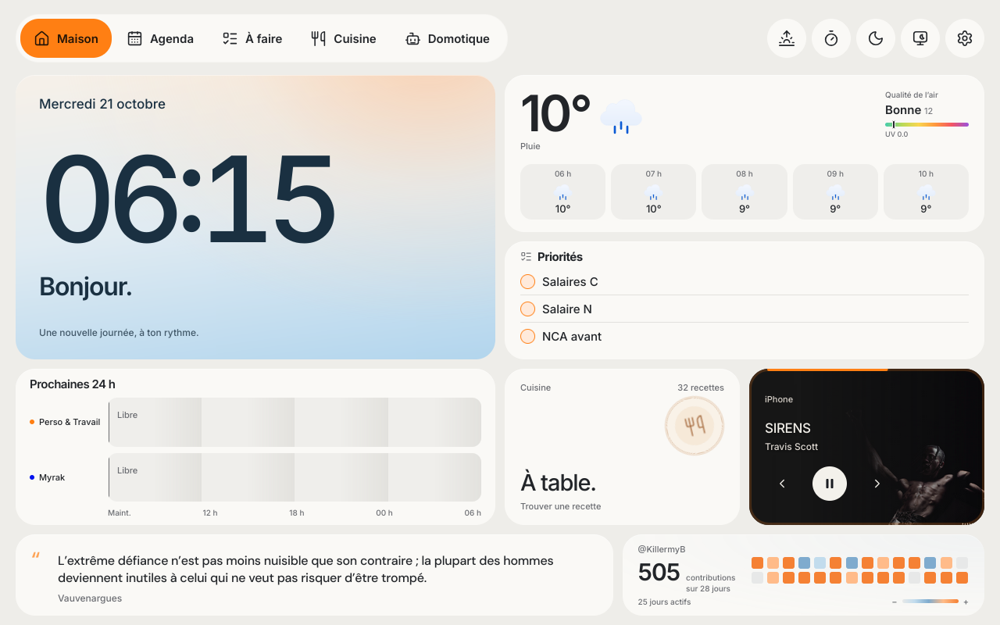

# Android Smart Home Hub

A touch-friendly smart home dashboard for **Android tablets and digital photo frames**, built for **AiMOR PF1007 / PF1007L**.

Weather, shared calendars, Todoist tasks, recipes, Spotify controls and Home Assistant in one home display. French interface, designed for touch.



```sh
git clone https://github.com/KillermyB/android-smart-home-hub.git
cd android-smart-home-hub
npm start
```

Node.js 22.9+ · Open http://localhost:4173 · [Configuration](docs/CONFIGURATION.md) · [Full guide](docs/GUIDE.md)

Inspired by **[Wes Bos and the photo-frame-dashboard contributors](https://github.com/wesbos/photo-frame-dashboard)** and their work on Android photo frames and community builds.

Keys, tokens and private exports stay outside the repository. Third-party resource licenses are preserved in `dist/licenses/` and `dist/fonts/`.
